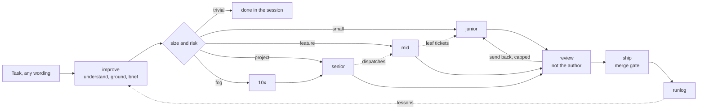

# agent-skills

A small set of agent skills that run a personal software factory: a task goes
in, in any wording, and a reviewed pull request comes out, waiting for your
word to merge. This repository
holds the skills, the graph of how they depend on each other, the scripts that
enforce the rules, and the research behind the design.

Status: **v0.1, not yet run on a real ticket.** The design is grounded in
measured findings and in published practice, but the pipeline as a whole still
has to pass its pilot. See [What is proven and what is not](#what-is-proven-and-what-is-not).

## The idea

You type one of two commands.

- **`/improve <task>`** is the front door only. It works out what you are
  asking, checks it against the project as it is today, and writes a clear
  brief for the next agent. Then it stops.
- **`/factory <task>`** manages everything. It runs `improve`, decides how much
  process the task deserves, gives the work to the right seat, has it reviewed
  by someone who did not write it, takes it to the merge gate, logs the run and
  reports back.

Behind those are four **seats** you can also call directly (`/junior`, `/mid`,
`/senior`, `/10x`) and eight **procedures** that the seats load one at a time,
only when a step needs them.



## The skills

| Layer | Skill | You type it | What it is |
|---|---|---|---|
| 0 Manager | `factory` | yes | Runs the whole loop and owns the ledger |
| 1 Front door | `improve` | yes | Rough words in, agent brief out. Stops |
| 2 Seats | `junior` | yes | One ready ticket, one small PR |
| | `mid` | yes | Owns a feature: tickets, build, junior review |
| | `senior` | yes | Spec gate, fan-out, risky review, merge gate |
| | `10x` | yes | Unblocks: fog, design forks, council, rescue |
| 3 Procedures | `spec` | no | The spec and its gate |
| | `tickets` | no | Vertical slices with file ownership |
| | `dispatch` | no | The orchestration layer: caps, placement, models, worker brief |
| | `build` | no | One ticket, failing check first, observed proof |
| | `review` | no | Independent review on two axes, capped fix loop |
| | `ship` | no | PR, checks, merge gate |
| | `handoff` | no | The note that lets a fresh session continue |
| | `runlog` | no | One row per run, the lesson, and how a lesson becomes a change |
| | `principles` | no | Six rules that several skills share, one short file each |

Six skills are typed by you. Their descriptions total about 1,000 characters.
Every skill is called by name only, so none of them is loaded until you ask.

### Cost at a glance

| You type | Reads at once | Upper bound if it loaded everything |
|---|---|---|
| `/improve` | about 2,200 tokens | about 2,200 |
| `/junior` | about 600, plus the procedures it uses | about 5,600 |
| `/factory` | about 1,500, plus one stage at a time | about 18,200 |

Standing cost is zero. These are bytes divided by 4, not measurements; the
full table is generated into [docs/skill-graph.md](docs/skill-graph.md).

The full dependency graph, generated from the skills themselves, is in
[docs/skill-graph.md](docs/skill-graph.md). An interactive version you can
drag, filter and click through is `docs/skill-graph.html`: open it in a browser.

## Read next

| Document | What it answers |
|---|---|
| [docs/architecture.md](docs/architecture.md) | The layers, the tree and its subtrees, the rules, and the decisions behind them |
| [docs/skill-graph.md](docs/skill-graph.md) | Which skill loads which, and how big each one is |
| [docs/fleet.md](docs/fleet.md) | How the manager, subagents, threads and machines work together |
| [docs/validation.md](docs/validation.md) | How review, proof and the merge gate work, and which parts are enforced by code |
| [docs/migration.md](docs/migration.md) | How this maps to the skills in use before, and how to try it safely |
| [docs/research/industry-patterns.md](docs/research/industry-patterns.md) | What Matt Pocock, Theo Browne and others publish, and what was taken from each |
| [docs/research/upstream-skills.md](docs/research/upstream-skills.md) | A close reading of the four third-party skill repos |
| [docs/research/findings.md](docs/research/findings.md) | What was tried and measured here, and the rule each finding produced |
| [docs/research/pstack.md](docs/research/pstack.md) | Lauren Tan's pstack and the T3 multi-agent note: what was taken, what was not, and why |
| [docs/plans/2026-11-26-next-round.md](docs/plans/2026-11-26-next-round.md) | The second round of changes, ticket by ticket, with its status |
| [evals/scenarios.md](evals/scenarios.md) | The cases the skills must get right |

## Install

One command per agent. Each one installs every skill and the scripts, and
updates itself when a new version is released.

**Claude Code** (2.1.275 or later):

```
claude plugin install agent-skills --marketplace rishi23root/agent-skills
```

**Codex:**

```
codex plugin marketplace add rishi23root/agent-skills
codex plugin add agent-skills@rishi23root
```

These install for your user, in every project. To try it in one project first,
add `--scope project` to the Claude Code command. Restart the agent session,
then type `/factory` or `/improve` followed by a task.

The optional third-party extras are a second step. Ask the agent to set up
the extras, or run the command printed in any seat's `extras.md`. They go in
`~/.agent-skills/upstream`, outside the plugin, so an update does not wipe
them.

Requirements: Node 20 or later, git, and an authenticated GitHub CLI (`gh`).
Python 3 for tstack's `babysit-pr` extra.

## Install from a clone (for working on the skills)

Nothing here installs itself. Start with one test project so it cannot affect
the skills you already use.

```
git clone https://github.com/rishi23root/agent-skills.git
cd agent-skills
node scripts/validate.mjs                       # check the skills and the graph
node scripts/install.mjs --target <project>/.claude/skills --dry-run
node scripts/install.mjs --target <project>/.claude/skills
```

Restart the agent session in that project, then type `/improve` or `/factory`
followed by a task. To take it out again:

```
node scripts/install.mjs --target <project>/.claude/skills --remove
```

Optional third-party extras, pinned to known commits. Fetch them before you
install, so `local.md` records the folder:

```
node scripts/sync-upstream.mjs        # clones into ./upstream, which is not in git
```

Per-project settings (tracker, labels, test commands) go in the project as
`docs/agents/factory.md`. Copy [templates/factory.md](templates/factory.md).

Rules of your own that a reviewer should apply to every diff go in the
project as `checks/`, one plain-English rule per file. Copy
[templates/checks](templates/checks).

## Scripts

| Script | What it does |
|---|---|
| `scripts/validate.mjs` | Checks every skill against the rules. Regenerates the graph and the per-seat extras lists with `--write`. Runs in CI |
| `scripts/graph.mjs` | Builds `docs/skill-graph.html`, an interactive graph of the skills, the pinned extras, their provider repos and the newest plan. Open the file in a browser |
| `scripts/install.mjs` | Links or copies the skills into a skills folder you name. Refuses to overwrite anything it did not install |
| `scripts/sync-upstream.mjs` | Clones the pinned third-party repos |
| `scripts/runlog.mjs` | Adds, closes, summarises and audits run log rows. The log is append-only |
| `scripts/gate.mjs` | Reads a PR's real state and checks the merge gate. Never merges |
| `scripts/call-graph.mjs` | Builds an interactive page of which skill calls which, across the core and every pinned library |

## What is proven and what is not

| Claim | Status |
|---|---|
| Fewer always-loaded skills cut context cost (25 live to 7, 4,539 to 2,039 description chars) | Measured, see findings |
| One thread per ticket raises total tokens | Reasoned, not yet measured |
| A workhorse model can follow `improve` and `factory` on five sample requests | Tried once on 2026-11-24, see `evals/scenarios.md` |
| Rules written only as prose are not followed reliably | Observed, and the reason for the scripts here |
| The skills are internally consistent (names, layers, links, sizes) | Checked by `validate.mjs` on every push |
| The run log, install and gate scripts work | Run log and install were exercised locally. The gate script was run once against a real, already merged PR and correctly reported the gate as not met. It has not yet passed a PR, and its patch-id path has only been tested on its parts |
| A pinned extra never calls a skill that is not pinned | Checked by `validate.mjs --upstream` in CI. It found five broken calls on 2026-11-26 |
| A reviewer from another provider catches more | Reported by others (see `docs/research/pstack.md`). Not measured here |
| Proof-by-run, project checks and the reflect loop change outcomes | **Not yet tested.** Scenarios F1 to F14 in `evals/scenarios.md` |
| The whole loop produces a good PR from a rough task | **Not yet tested.** The pilot is the next step |
| The sizing table sends tasks to the right seat | **Not yet tested.** See `evals/scenarios.md` |

## Credits

The core is written here, in its own words. The ideas come from people who
published theirs: Matt Pocock (`mattpocock/skills`), Theo Browne
(`t3dotgg/tstack`), Dietrich Gebert (`ponytail`), Julius Brussee (`caveman`),
Lauren Tan (`pstack`, in `cursor/plugins`),
Jesse Vincent (`obra/superpowers`) and Anthropic's engineering posts. The
research documents say which idea came from where. Their repositories are not
copied into this one. They are referenced by pinned commit in
`upstream.lock.json`.
