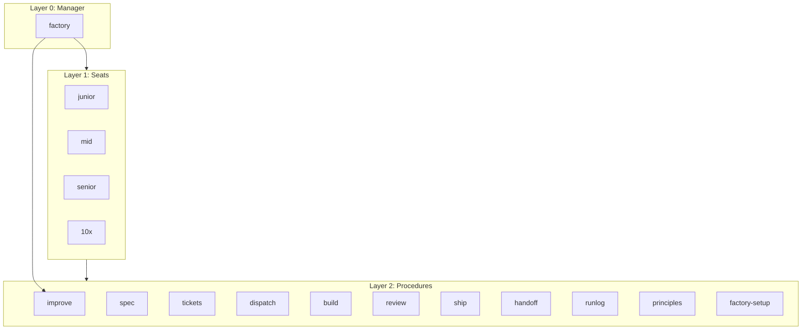
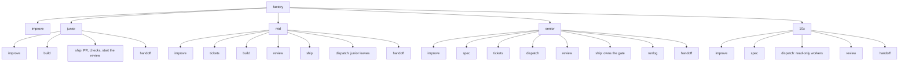
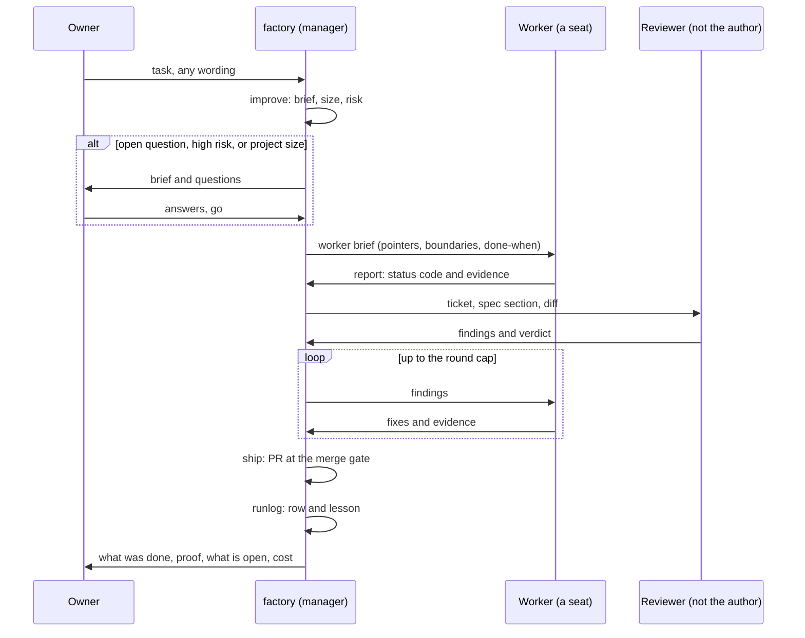

# Architecture

## What this is for

One person runs several coding agents across more than one provider and
machine. The goal is to hand over a task in ordinary words and get back a
change that has been built, checked by someone other than its author, and left
ready to merge, without paying for more process or more tokens than the task
deserves.

## Three layers

| Layer | Answers the question | Typed by you |
|---|---|---|
| 0 Manager | How much process does this task need, and is the result real? | `/factory` |
| 1 Seats | Who does the work, and what may they decide alone? | `/junior` `/mid` `/senior` `/10x` |
| 2 Procedures | How is one step done properly? | six of eleven: `/improve` `/review` `/spec` `/ship` `/handoff` `/factory-setup`. The rest are loaded only |

`improve` is the front door: the procedure that answers "what is actually
being asked, in this project, today?". `factory` and every seat load it when a
task arrives as rough words. `review`, `spec`, `ship` and `handoff` can be
typed too, for one step on work that has no ticket. Each says what it does in
that case under "Typed by the owner, with no ticket". `factory-setup` is typed only.
Nothing loads it, because it runs before the factory can.

**The layer rule.** A skill may load only skills in a layer below it.
Procedures may also use each other. Nothing points up. This is what makes the
set a tree rather than a web, and `scripts/validate.mjs` fails the build if an
edge breaks it.

## The tree and its subtrees

`factory` is the root. Each seat is a subtree: the seat's contract at the top,
and under it only the procedures that seat is allowed to run.

Three things follow from this shape.

1. **You can enter at any node.** `/factory` walks the whole tree. `/mid`
   starts at one subtree. `/improve` is a single leaf. Each still works alone.
2. **A subtree shows what a seat is for.** `junior` lists no `dispatch` and
   no `review`, so starting builders and approving are simply not among its
   steps. The one worker a typed `junior` starts is the reviewer that `ship`
   calls for. This is guidance by structure, not a lock: nothing prevents an
   agent from reading another file. `validation.md` says which rules are
   enforced.
3. **Loading is lazy.** A seat reads a procedure when its step starts, never
   up front. A `junior` run on a small ticket loads three procedures.

A second, optional subtree hangs under each seat: third-party **extras**,
listed in `skills/<seat>/extras.md`. They are pinned in `upstream.lock.json`,
they are never needed for the core loop, and they cannot override a rule here.

## The flow

## The contracts between stages

Each stage hands the next one a fixed artifact. The format has exactly one
owner.

| Artifact | From, to | Owned by |
|---|---|---|
| Readiness table: what a machine and a project still lack | factory-setup to the owner | `scripts/setup.mjs` |
| Agent brief | improve to factory, a seat or spec | `skills/improve/brief-format.md` |
| Size and risk | improve to factory | `skills/improve/sizing.md` |
| Spec | senior to tickets | `skills/spec/SKILL.md` |
| Review voices: how many, from which providers, how a council runs | review, spec and 10x to the top session | `skills/review/council.md` |
| Reviewer's level: one seat above the author, and the line its brief carries | manager to reviewer | `skills/review/SKILL.md`, "Who reviews", and `skills/review/level.md` |
| Ticket and its Technical Dependencies block | mid to a builder | `skills/tickets/ticket-format.md` |
| Worker brief | manager to worker | `skills/dispatch/SKILL.md` |
| Worker report and status code | worker to manager | `skills/dispatch/report-format.md` |
| Locator map | read-only locators to the top session | `skills/dispatch/report-format.md`, "Locator replies" |
| Findings and verdict | reviewer to manager | `skills/review/SKILL.md` |
| When a review starts, and who starts it | an open PR to the top session | `skills/ship/SKILL.md`, "Start the review" |
| Merge gate | ship to owner | `skills/ship/SKILL.md` |
| Handoff note | one session to the next | `skills/handoff/SKILL.md` |
| Run row | every run to the log | `skills/runlog/SKILL.md` |
| A rule shared by several skills | any skill to its reader | one file in `skills/principles/` |
| Project check | a project to every reviewer | the project's `checks/` folder, from `templates/checks` |
| Proposed skill change | a retro to the owner | `skills/runlog/reflect.md` |
| Repo profile | a project to every skill | `templates/factory.md` |

## Design rules

1. **Scale the process to the task.** The sizing table is the first decision.
   A trivial task runs no seat at all.
2. **Everything is called by name.** No skill sits in the context waiting to
   be triggered. This came from a measured audit, in `research/findings.md`.
3. **Few doors.** Eleven typed skills: the manager, four seats and six
   procedures that make sense as a single step. The other five are reached
   through them.
4. **One copy of each rule.** A format or a number lives in one file. Other
   files link to it. A rule that two or more skills rely on is a file in
   `skills/principles/`, and the validator fails on one that nothing cites.
5. **Prose is not a mechanism.** A rule that must hold every time gets a
   script or a checkable condition. `validation.md` lists which rule has which.
6. **Ask before guessing.** A missing fact that changes the design stops the
   work. A flagged guess that is acted on is still a guess.
7. **Pass pointers, not content.** Workers get links and paths.
8. **The author never approves.** Review is by a different agent with a clean
   context.
9. **Evidence, not assertion.** A report quotes output that was seen.
10. **Stop cleanly when blocked.** Leave the PR open and say why.

## Decisions

| # | Decision | Why | What would change it |
|---|---|---|---|
| 1 | Own core, third-party extras pinned by commit | The core must work from a fresh clone and must not change when someone else pushes | An extra used in most runs should be rewritten into the core |
| 2 | Two main entry points, `factory` and `improve` | Sometimes the whole loop is wanted, sometimes only a better prompt | If `improve` is never used alone, fold it into `factory` |
| 3 | Seats are named `junior`, `mid`, `senior`, `10x` | Different from the older `*-dev` skills, so both sets can be installed side by side during the trial | After migration the old ones are removed |
| 4 | `client-brief` is folded into `improve` | Client words are one kind of rough input. One front door, one brief format | If client-facing work needs its own output, split it back out |
| 5 | Subagent or own thread is decided by where the result lands | A testable rule replaces "how related is it", which was never defined | Pilot data showing the rule picks badly |
| 6 | One quota floor, 15 percent | Three different numbers were in use (5, 10, 15) | Run log data |
| 7 | Tiers are classes, not model names | Model names go stale in months | n/a |
| 8 | Dependencies live in each skill's `metadata` | The graph is generated from the same file the agent reads, so it cannot drift | n/a |
| 9 | Review verdict is a comment line naming the commit | One GitHub account cannot approve its own PR, so a GitHub approval is not available to a solo owner | A second reviewer account, or a bot identity |
| 10 | Nothing installs itself | The existing skills keep working until the owner switches | n/a |
| 11 | Shared rules are files inside a `principles` skill, not a new top-level folder | The installer, the link check and the graph already understand a skill folder, so no new mechanism was needed. Six files, each under 600 bytes | A principle cited by only one skill goes back into that skill |
| 12 | pstack is a source of ideas and a few pinned extras, not a runtime | Its router loads about 11 KB every session, lets workers start workers, and rejects planning, review rounds and asking the owner. Each of those is the opposite of a rule here | n/a |
| 13 | A blocking review finding needs a run that shows the failure | A reviewer asked to find something always finds something. A command and its output can be checked by the author and the owner | Run log data showing real defects were waved through as suspicions |
| 14 | A review verdict covers a patch id as well as a commit | A rebase changes the commit and not the change, and used to void every approval | n/a |
| 15 | The run log is append-only | A row that can be rewritten cannot be audited | n/a |
| 16 | `improve` is a procedure that stays typeable (2026-11-27) | A seat typed directly with rough words had no way to get a brief: the layer rule stopped it loading a skill above it. As a procedure every seat may load it, and it stays typeable | n/a |
| 17 | `review`, `spec`, `ship` and `handoff` are typeable; `tickets`, `dispatch`, `build`, `runlog` and `principles` are not (2026-11-27) | Each of the four is a whole step the owner sometimes wants alone, on work with no ticket. The five hidden ones need a ticket, a ledger or a caller to mean anything. The list is one constant in `scripts/validate.mjs` | Run log showing a typed procedure is never typed, or a hidden one is wanted alone |
| 18 | The council belongs to `review`, and `spec` and `10x` read it from there (2026-11-27) | It was reachable only through `10x`, so a review or a spec that needed several providers had to escalate two seats to get them. Every review now states `Voices: <number>, <reason>`. The top session starts the voices, so depth stays two | Run log showing councils are called where one reviewer would have found the same thing |
| 19 | Every review includes a model from another provider; risk sets how many voices, one to three or more (2026-11-27) | The owner's rule. Same-family reviewers share the author's blind spots, and that matters on small PRs too. The cost is one review per PR on another provider, and a written waiver from the owner whenever none can run | Run log showing other-provider reviews on normal-risk PRs find nothing a same-provider review missed |
| 20 | The repository is also a Claude Code and Codex plugin, from `.claude-plugin/` | One command installs every skill with the scripts beside them and updates itself, the route `mattpocock/skills` uses. A plugin install writes no `local.md`, so `principles/locations.md` says how a skill finds the scripts and the extras without it. No setup skill was added: the extras lists carry the one command | A harness that drops the scripts from its plugin copy, or extras that most runs need |
| 21 | A change is reviewed at the level one seat above its author, under the review procedure and without loading that seat's skill (2026-11-27) | The owner's rule. A reviewer one step up has the experience to catch what the author missed, without spending the top seat on every risky PR. "Mid or senior" let a peer review a `mid` PR, and risk `high` jumped to `senior` whoever the author was. A reviewer told "review as `senior`" loaded the seat and read duties it must not have: the spec gate, starting workers, the merge gate. Risk still sets the number of voices. The level also sets the model's tier, so a `mid` PR at normal risk now costs a frontier review | Run log showing reviews one seat up find nothing a same-level review on a stronger model would have |
| 22 | Caveman-style terse output is a core principle for chat and PRs (`skills/principles/terse-output.md`) (2026-11-27) | The owner's rule. Chat reports, PR bodies and PR reviews were too wordy. Upstream `caveman` is an optional extra and explicitly drops terse style on PRs; putting our own rule in `principles` covers every run, keeps PRs short, and preserves exact proof, markers and safety warnings | Run log or owner feedback showing terse PRs hide risk or confuse readers |
| 23 | `factory-setup` is a typed procedure that nothing loads, with its checks in `scripts/setup.mjs`. It replaces the last sentence of decision 20 (2026-11-27) | The owner's words: setup is needed when setting things up for the first time, and it should ask for everything a factory run may need. The requirements were one prose line that nothing checked. A commit failed for want of a git identity, the plugin was missing from the owner's own session, and the PR webhook was never wired. What can be checked is a script, because prose is not a mechanism. The skill only asks, shows, and writes on a yes. The validator's rule that every skill is reachable from `factory` has one named exception, since setup runs before the factory can | A harness that checks all of this itself, or run log lessons showing the table says `ok` where a run then fails |
| 24 | Within a tier, the provider families are peers, chosen by fit for the role, spread across families and by quota, with the run log deciding once it has ten rows for a task type (`skills/dispatch/allocation.md`). A failed start moves to another candidate without asking. A provider that asks for approval on each shell command is skipped only for unattended work that runs commands. The different-provider review rule stays, as a filter first (2026-11-28) | The owner's rule. A second review stopped twice to ask which provider to try after one failed, and the profile ranked one reviewer provider above another. The owner does not want any family treated as a lesser fallback: each does well at different work. A fallback is not the owner's decision; only a gap at the gate is. Leaderboards disagree and none measures review, so they only place a model in a tier | Run log rows showing one family clearly better at a task type, or a harness that falls back by itself |
| 25 | A worker builds every `small` and larger change by default; building in the top session is a stated exception (`skills/factory/SKILL.md` step 4). Grounding spread over several areas is located by parallel read-only workers, and the manager reads their map (`skills/dispatch/brief.md`) (2026-11-28) | The owner's rule. The manager's frontier context was spent on edits and filled with file reads. Builders are now chosen by fit on cheaper tiers (decision 24), so a fresh builder costs less than the manager's context | Run log rows showing worker builds on `small` tickets cost more in total, or fail more, than in-session builds |

## Open questions

- Does the sizing table route correctly on real tasks? Only the pilot can say.
- Is three review rounds the right cap? It is borrowed, not measured here.
- Every review needs another provider. On a machine with only one provider,
  the owner must waive that on every PR. Is that too strict?
- Does proof-by-run let real defects through as suspicions? A reviewer that
  cannot run the product can prove little. Watch the suspicion counts.
- Project checks cost reviewer tokens on every PR. How many files before the
  cost outweighs the catch?
- A solo owner has one GitHub account, so the review verdict is a comment and
  not a GitHub approval. A second reviewer identity would close that gap.
- Should the run log be filled by a hook instead of by the manager? A hook
  would be a mechanism. Today it is an instruction backed by a script.
- Can a worker on the second machine be started by an agent? Not until that
  machine is linked in the harness.
