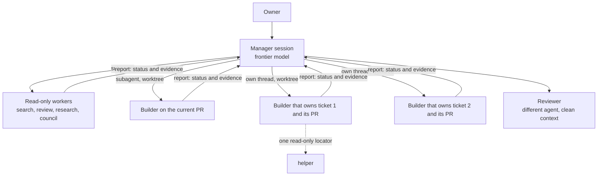
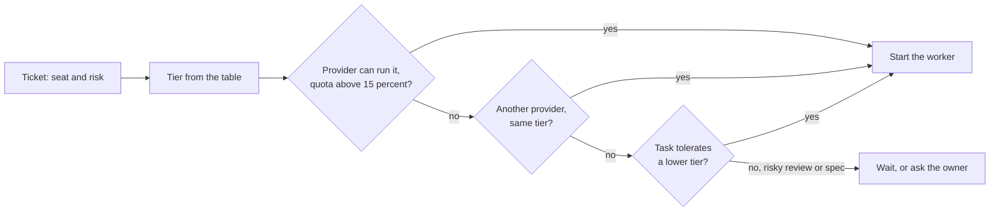

# Fleet and subagents

How one manager session, its workers, separate threads and more than one
machine work together. The rules themselves live in
`skills/dispatch/SKILL.md`. This page explains them.

## Vocabulary

| Term | Meaning |
|---|---|
| **Manager** | The top session, whichever skill it was started with (`factory`, or a seat called directly). It is the only one that dispatches |
| **Worker** | Any run the manager starts. A builder works as `junior` or `mid`. `senior` and `10x` never run as workers |
| **Subagent** | A worker inside the manager's session. Its result comes back to the manager |
| **Own thread** | A worker that is a separate conversation. It owns one ticket and that ticket's PR |
| **Seat** | The level a worker works at: junior, mid, senior or 10x |
| **Fleet** | All workers in flight at one time |
| **Orchestration layer** | `dispatch`, plus the harness tools it calls |

## Shape

Depth is two: manager, then worker. A worker never starts workers, apart from
one read-only helper to find code. This is deliberate. Every extra level
multiplies cost and hides failures from the one session that holds the plan.

## Subagent or own thread

The test is where the result lands.

| The result | Placement |
|---|---|
| Lands on the branch this session is building | Subagent |
| Is a finding, not a change (search, review, research) | Subagent |
| Has to be integrated by the manager before anything is pushed | Subagent |
| Is its own PR and needs nothing unpublished from this session | Own thread |

Unsure means subagent. An own thread is the more expensive choice: it pays a
full cold start and it needs its own review slot.

## The clone gate

Before any builder starts, five things must be true: what to build is settled
for the size of the work, the ticket has no open question, its files do not
overlap a ticket in flight, a review slot is free, and the caps are respected.

The third point is the one that makes parallel work safe. Every ready ticket
names the files it may change in its `Touches` line. Two tickets with
overlapping `Touches` never run at the same time.

## Caps, and why review is the real limit

| Mode | Builders | Reviews | Workers of any kind |
|---|---|---|---|
| Pilot | 1 | 1 | 3 |
| Steady | 4 | 2 | 6 |

A repository is in pilot mode until its profile says otherwise, and only the
owner changes that.

Builders are cheap to start. Review is not, and a person is usually the last
reviewer. If builders finish faster than reviews clear, the result is a queue
of stale PRs that conflict with each other. So the rule is: when two PRs are
waiting for review, start no builder.

Adding workers to late work makes it later. Each new worker has to be briefed,
its output has to be integrated, and its PR has to be reviewed.

## What parallel work costs

Each worker starts cold and reads its way in. So four workers on four tickets
should spend more tokens in total than one session doing the four in a row.
What they buy is wall-clock time, and a clean context per ticket, which should
improve accuracy on each one. This is reasoned from how the runs work. It has
not been measured here yet, and the run log exists to measure it.

So: run in parallel when the tickets are independent and time matters. Run in
sequence, with a handoff between tickets, when they are not or it does not.

## Models

The manager runs on the strongest model, because it holds the plan and judges
the results. Workers run on the cheapest model that fits their seat and risk.
Search and reading go to the fastest model.

The table is `skills/dispatch/allocation.md`. It changes only when the run log
has at least ten rows for a task type and model.

## Machines

A second machine helps only if an agent can start work on it. In T3 Code that
requires the machine to be **linked**, not just paired. Until then the second
machine is used by hand. A machine with less than 16 GB of memory runs at most
two active workers.

## What the manager keeps

The ledger: ticket, seat, worker, state, PR, open findings. It does not keep
the workers' transcripts, and it does not poll. When asked how a worker is
doing, it reads that worker, then answers.

## Failure modes this design is built against

| Failure | Guard |
|---|---|
| Two builders overwrite each other | `Touches` on every ticket, a worktree per builder |
| A worker says "done" and it is not | Status codes, quoted evidence, independent review |
| A worker reads the whole repository | The brief gives pointers and boundaries |
| The manager forgets state after a long run | The ledger, on the ticket or in a file |
| A PR bounces forever | A round cap, then a stronger seat or model |
| Fan-out burns a quota | Caps, the quota floor, the review limit |
| A worker starts its own workers | Depth of two, stated in every worker brief |
| An instruction arrives inside a worker's report | A report is a claim, never an order |
