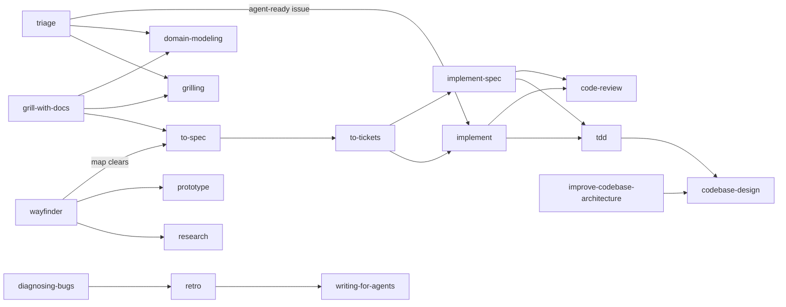
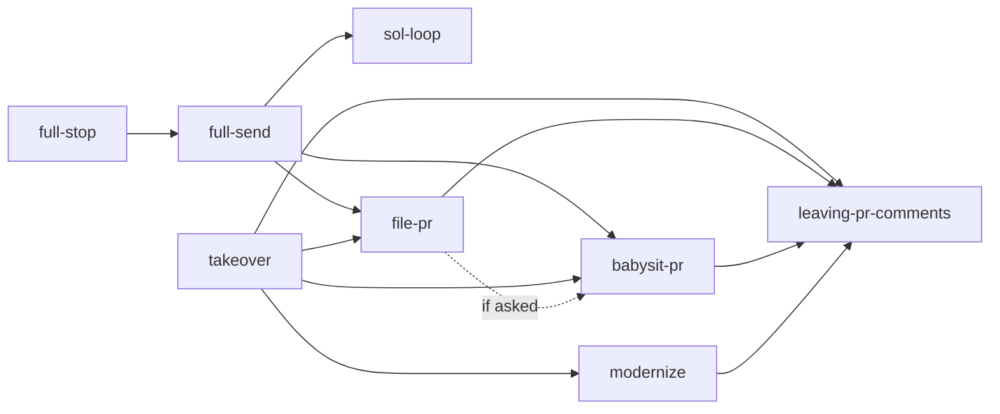
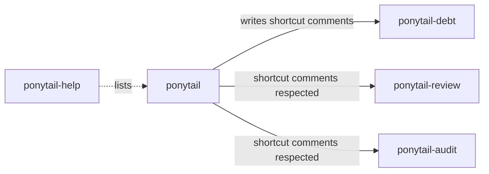
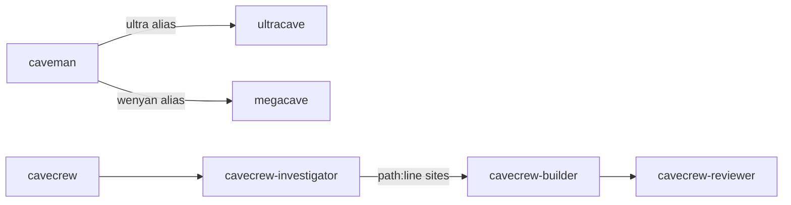

# Upstream skills: what each repo teaches

Read from the local clones under `D:\skills\upstream`. Statements come from the SKILL.md files and READMEs. Anything marked "(inference)" is mine. Invocation: "user" means `disable-model-invocation: true`; "model" means the frontmatter has no such flag, so the description triggers it; "unclear" means neither source settles it.

## 1. mattpocock/skills (Matt Pocock)

**Core idea.** Agents fail mainly through misalignment, so make the human and agent agree before code: a "grilling" interview, a shared glossary, then small tracer-bullet tickets. The README says these are small, composable pieces and rejects frameworks (GSD, BMAD, Spec-Kit) that "own the process". `ask-matt` is the router that states the main flow: idea, grill, spec, tickets, implement, review, retro.

| Skill | What it does | Invocation | Calls / depends on |
|---|---|---|---|
| `setup-matt-pocock-skills` | Configures tracker, triage labels, doc layout once per repo | user | none |
| `ask-matt` | Router: which skill fits | user | names most skills below |
| `grilling` | Interview in rounds over a design tree | model | none |
| `grill-me` | Stateless grilling, no repo | user | `grilling` (per README) |
| `grill-with-docs` | Grilling that updates GLOSSARY.md and ADRs | user | `grilling`, `domain-modeling` |
| `domain-modeling` | Sharpen terms, write glossary and ADRs inline | model | none |
| `codebase-design` | Deep-module vocabulary (module, seam, depth) | model | none |
| `research` | Background agent writes a cited Markdown file from primary sources | model | none |
| `prototype` | Throwaway code to answer one design question | model | none |
| `to-spec` | Synthesizes the conversation into a spec on the tracker | user | none |
| `to-tickets` | Splits a spec into tracer-bullet tickets with blocking edges | user | none |
| `implement` | Builds one spec or ticket | user | `tdd`, `code-review` |
| `implement-spec` | Builds a whole spec via subagents on one integration branch | user | `tdd`, `code-review` |
| `tdd` | Red-green loop at agreed seams | model | `codebase-design` |
| `code-review` | Two-axis review (Standards, Spec) by parallel sub-agents | model | none |
| `pr` | PR body shape: summary visual, evidence, merge danger | model | none |
| `triage` | Moves incoming issues through a label state machine | user | `grilling`, `domain-modeling` |
| `diagnosing-bugs` | Feedback-loop-first debugging | model | none |
| `improve-codebase-architecture` | Finds deepening opportunities, HTML report | user | `codebase-design`, `grilling` |
| `wayfinder` | Maps a huge effort as decision tickets, resolves one per session | user | `grilling`, `domain-modeling`, `research`, `prototype` |
| `retro` | Suggests changes to the agent's environment | user | `writing-for-agents` |
| `handoff` | Writes a portable handoff file | user | none |
| `wait-what` | Re-pitches a message that did not land | user | none |
| `to-questionnaire` | Turns a blocked decision into a questionnaire for someone else | user | none |
| `teach` | Multi-session teaching in a stateful workspace | user | none |
| `wizard` | Generates a bash wizard for human-only steps | model | none |
| `writing-for-agents` | How to write skills and AGENTS.md | model | none |

**Distinctive mechanisms**
- Label state machine: five state roles (`needs-triage`, `needs-info`, `ready-for-agent`, `ready-for-human`, `wontfix`) plus a category; each issue carries exactly one of each, and conflicts stop the run. `triage/SKILL.md`.
- Agent brief: a comment that is "the contract", written for durability (no file paths or line numbers, behavior not procedure, testable criteria, explicit out of scope). `triage/AGENT-BRIEF.md`.
- Blocking edges and frontier: tickets declare "Blocked by"; the frontier is every ticket whose blockers are done. Wide refactors use expand, migrate in batches, contract. `to-tickets/SKILL.md`.
- Fresh context per subagent, one worktree per ticket, merger subagent, one `code-review` over the integration branch; communication by "context pointers". `implement-spec/SKILL.md`.
- Feedback-loop ladder: ten ways to build a pass/fail signal, from failing test down to a human-in-the-loop script, before any theorizing. `diagnosing-bugs/SKILL.md`.
- Phase-boundary tree: continue, `/clear`, `/handoff`, subagent, `/compact`, asked in that order; first yes wins. `ask-matt/PHASE-BOUNDARIES.md`.

## 2. tstack (Theo Browne, t3dotgg)

**Core idea.** Take a change from "done" to a merged PR with nobody watching, by requiring proof, an outside reviewer, and a written merge gate. Skills trigger on spoken phrases ("full send", "council"). Some use T3 Code features (`delegate_task`, `watch_pull_request`) with native fallbacks.

| Skill | What it does | Invocation | Calls / depends on |
|---|---|---|---|
| `full-send` | Change to merged PR, autonomously | model (phrase "full send") | `sol-loop`, `file-pr`, `babysit-pr` |
| `full-stop` | Same, stops when PR is ready; never merges | model (phrase) | `full-send` |
| `sol-loop` | Looped review by a GPT Sol reviewer until agreement | model (phrase) | none |
| `council` | Review by three models from three providers | model (phrase) | none |
| `file-pr` | Short PR that leads with the problem | model | `leaving-pr-comments`, `babysit-pr` (if asked) |
| `babysit-pr` | Watches CI and bots, fixes real findings | model | `leaving-pr-comments` |
| `modernize` | Rebases an old PR and decides whether it should exist | model | `leaving-pr-comments` |
| `takeover` | Finishes someone else's PR or thread, keeps credit | model | `modernize`, `file-pr`, `babysit-pr`, `leaving-pr-comments` |
| `leaving-pr-comments` | Attribution and style for comments posted for the user | model (README: automatic) | none |

**Distinctive mechanisms**
- Merge gate: proof covers the diff, required checks green, review bots finished with each finding fixed or dismissed in writing, no human change request, branch current and mergeable; never `--admin`. `full-send/SKILL.md`.
- Proof rule: evidence you observed this session; no proof means ask the user. Green mocked tests do not count for UI. `full-send/SKILL.md`.
- Round budget and ledger: 3 review rounds (5 for security, auth, data loss, concurrency), stop on nit-only rounds, stable finding ids, severities `blocker`/`should`/`nit`, reply `VERDICT: APPROVE or CHANGES`. `sol-loop/SKILL.md`.
- Score table: three delegates score out of 10 per round, written into the PR description. `council/SKILL.md`.
- Disposition before pushing: `MODERNIZE`, `REWORK`, or `CLOSE`; age alone is not evidence. `modernize/SKILL.md`.
- Hard limits: one watcher per PR, `--force-with-lease` only, comments carry a `[!NOTE]` attribution callout. `babysit-pr`, `modernize`, `leaving-pr-comments`.

## 3. ponytail (Dietrich Gebert)

**Core idea.** Act like a lazy senior developer: the best code is code never written. Solve the whole problem with the least new code, but never cut validation, error handling, security, or accessibility. The README reports measured savings (for example 53% less code in its own 39-task benchmark; those are the author's figures). Active every session by default.

| Skill | What it does | Invocation | Calls / depends on |
|---|---|---|---|
| `ponytail` | Always-on lazy-dev mode; levels lite, full, ultra | model; auto-active by default | none |
| `ponytail-review` | Reviews a change; report only | model and slash | none (reads `shortcut:` comments) |
| `ponytail-audit` | Same review for a whole repo, max 20 findings | model and slash | none |
| `ponytail-debt` | Collects `shortcut:` comments into a ledger | model and slash | `ponytail` convention |
| `ponytail-gain` | Shows benchmark savings | model and slash | none |
| `ponytail-help` | Reference card | model and slash | none |

**Distinctive mechanisms**
- Ladder of preference: does it need to exist, existing code, standard library, installed dependency, one line, then minimum code. `ponytail/SKILL.md`.
- Shortcut marker: `shortcut: <the limit>, <when to upgrade>`; review treats a marked shortcut as a decision, not a finding. `ponytail/SKILL.md`, `ponytail-review/SKILL.md`.
- Debt ledger: grep the markers, one row per marker, tag `no-trigger` when no upgrade path is named, end with counts. `ponytail-debt/SKILL.md`.
- Finding rule: "No case, no finding"; findings grouped Must fix, Should fix, Nice to have, each with four parts and a number so the user can say "fix 2 and 5". `ponytail-review/SKILL.md`.
- Closing lines: `Verdict:`, `Lean: -N lines`, `Not checked:`; every reply ends with what was skipped and any risk. `ponytail-review`, `ponytail`.
- Never-cut list and three levels (lite names the smaller option; ultra questions the request). `ponytail/SKILL.md`.

## 4. caveman (Julius Brussee)

**Core idea.** Cut tokens by making the agent say less and read less, while code, paths, numbers and errors stay exact. Output is terse fragments, answer first, no ceremony. The README also advertises cloud and product features, which this review skips. The "work pattern" skills (`lean-build` and others) are small checklists that "write less code" and stop at the acceptance condition.

| Skill | What it does | Invocation | Calls / depends on |
|---|---|---|---|
| `caveman` | Terse voice, persists until "normal mode" | slash; hook-enabled after install per README | `ultracave`, `megacave` (aliases) |
| `ultracave` | Fragments, one word where enough | user | none |
| `megacave` | Classical Chinese register | user | none |
| `caveman-commit` | Conventional Commits, intent only | model and slash | none |
| `caveman-review` | One-line findings with severity | model and slash | none |
| `caveman-compress` | Compresses a memory file, keeps backup | unclear (`/caveman-compress`) | none |
| `caveman-explore` | Read-only explorer returning `path:line` citations (Haiku preset) | unclear (subagent) | none |
| `cavecrew` | When to delegate to the three `cavecrew-*` subagents | model | `cavecrew-investigator`, `cavecrew-builder`, `cavecrew-reviewer` |
| `investigate-first` | Evidence before edits | model (README: picked up when task fits) | none |
| `surgical-patch` | Narrowest-layer bug fix | model | none |
| `lean-build` | Narrow feature build with stop condition | model | none |
| `safe-refactor` | Refactor with verification bracketing | model | none |
| `migration` | Reversible, expand-migrate-contract changes | model | none |
| `verify-and-stop` | Prove acceptance, then stop | model | none |

**Distinctive mechanisms**
- Auto-clarity: drop terse mode for security warnings, irreversible actions, scrambleable step order, confused users, and anything persisted outside chat (commits, PRs, tickets, docs). `caveman/SKILL.md`.
- Output contracts with terminal tokens: builder returns `too-big.`, `needs-confirm.`, `ambiguous.`, or `regressed.`; reviewer ends with `totals: N🔴 N🟡 N🔵 N❓`. `cavecrew/SKILL.md`.
- Distrust absence claims: check one targeted spot before accepting `No match.` or `No issues.`, and check cited lines exist. `cavecrew/SKILL.md`.
- Delegation table: locate, then fix, then verify; builder only when the file is known and the edit is at most two files. `cavecrew/SKILL.md`.
- Proof states: `verify-and-stop` separates pass, fail, unavailable, and blocked, and reuses still-current results. `verify-and-stop/SKILL.md`.
- Evidence-only reply: `path:START-END  reason`, only ranges actually read. `caveman-explore/SKILL.md`.

## How the four fit together

**Strongest stage per repo.**
- intake, spec, tickets: mattpocock (`grilling`, `to-spec`, `to-tickets`, `triage`, `wayfinder`). The others have nothing here.
- dispatch: mattpocock `implement-spec` (task graph, fresh subagents); caveman `cavecrew` (cheap, compressed delegates); tstack `council` and `sol-loop` use delegates for review only.
- build: ponytail (scope and size discipline) and mattpocock `tdd` (loop). Caveman's work patterns are shorter versions of the same discipline.
- review: all four. tstack gives the loop and stop rules, ponytail the finding format, mattpocock the two axes, caveman the cheapest output.
- ship: tstack (`file-pr`, `babysit-pr`, merge gate). mattpocock stops at commit or draft PR.
- retro: mattpocock `retro` (environment changes); ponytail `ponytail-debt` is a deferral ledger, not a retro (inference).
- Cross-cutting: caveman changes how replies read, not what the work is.

**Overlaps and differences.**
- Review loops: mattpocock `code-review` runs once, two axes, no rerank. tstack `sol-loop` iterates with a hard round cap and prefers fixes that delete code. ponytail reviews one pass with a "Lean" count. `caveman-review` and `cavecrew-reviewer` are format layers over the same job.
- PR bodies: mattpocock `pr` asks for Summary, Evidence, Merge Danger. tstack `file-pr` asks for a problem statement, solution, and a model line. Both ban inventory prose; the structures differ.
- Small-change discipline: ponytail "shortest working diff wins"; tstack tells agents to fix "the case that happened"; mattpocock `code-review` flags Speculative Generality. Same direction, different enforcement points.
- Debugging: mattpocock `diagnosing-bugs` (loop first) and caveman `investigate-first` (evidence, then edit) agree on order.

**Contradictions.**
- `lean-build` says never force work into one file or a local patch and to refactor when patching duplicates behavior. `ponytail` says keep the existing structure and take the shortest diff. They disagree on when to restructure.
- `tdd` requires seams confirmed with the user before any test. `full-send` says ask only when you cannot continue alone, and unseen questions stall the thread. An unattended run cannot do both.
- `to-spec` asks for an "extremely extensive" user-story list; `ponytail` asks for the smallest version of a vague request.
- Grilling ends only when the frontier is empty (no cap); `sol-loop` caps rounds at 3 or 5.
- PR drafts: `implement-spec` opens a draft PR; `file-pr` says open a real PR so review bots run.
- Attribution: `caveman-commit` drops AI attribution unless the user's own rule requires a trailer; `file-pr` requires a model line in the PR description. Different artifacts, so a conflict only if one rule is applied to both (inference).
- Voice: `caveman` forbids terse style in persisted artifacts, which is consistent with `leaving-pr-comments` and `file-pr`; `ponytail` asks for very simple English in reports. Keep one style rule per artifact type (inference).
