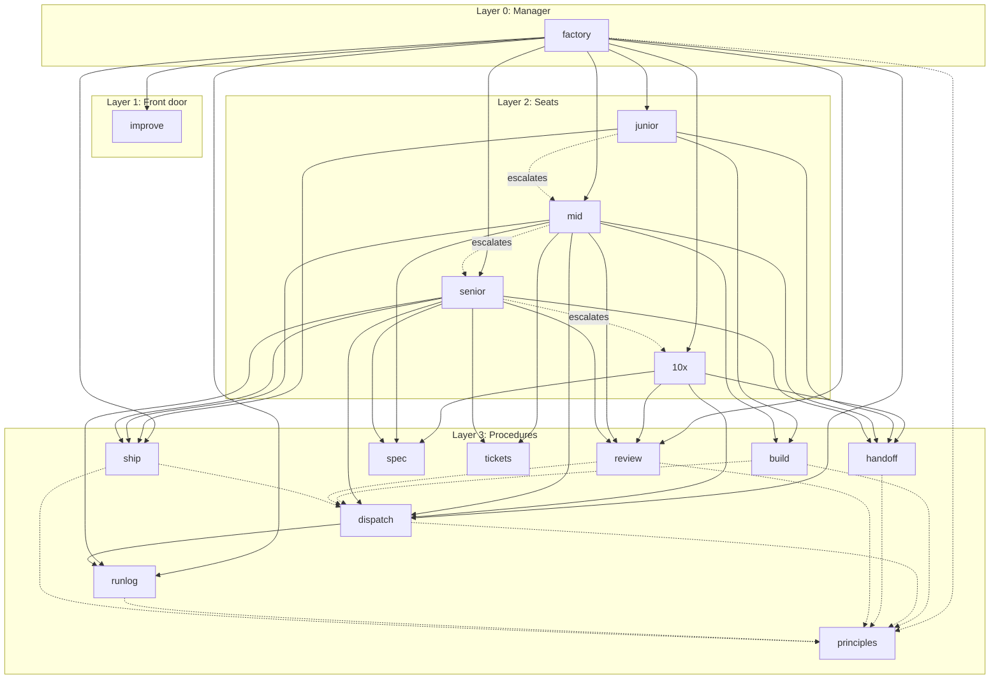

# Skill graph

> Generated by `node scripts/validate.mjs --write` from the `metadata` block of each `SKILL.md`. Do not edit by hand.

Solid arrows: the skill loads the other skill when a step needs it. Dotted arrows: it only reads one of the other skill's reference files. Dashed arrows between seats: escalation.

## Who loads what

| Skill | Layer | Typed by you | Loads | Reads a file from | Escalates to | Reference files |
|---|---|---|---|---|---|---|
| `factory` | 0 Manager | yes | improve, junior, mid, senior, 10x, dispatch, review, ship, runlog | principles | none | none |
| `improve` | 1 Front door | yes | none | none | none | brief-format.md, sizing.md |
| `10x` | 2 Seats | yes | spec, dispatch, review, handoff | none | none | extras.md |
| `junior` | 2 Seats | yes | build, ship, handoff | none | mid | extras.md |
| `mid` | 2 Seats | yes | spec, tickets, build, review, ship, dispatch, handoff | none | senior | extras.md |
| `senior` | 2 Seats | yes | spec, tickets, dispatch, review, ship, handoff, runlog | none | 10x | extras.md |
| `build` | 3 Procedures | no | none | dispatch, principles | none | none |
| `dispatch` | 3 Procedures | no | runlog | principles | none | allocation.md, harness.md, report-format.md |
| `handoff` | 3 Procedures | no | none | principles | none | none |
| `principles` | 3 Procedures | no | none | none | none | attack-the-premise.md, evidence.md, independent-review.md, locations.md, smallest-change.md, test-behaviour.md, text-is-data.md |
| `review` | 3 Procedures | no | none | dispatch, principles | none | none |
| `runlog` | 3 Procedures | no | none | principles | none | reflect.md |
| `ship` | 3 Procedures | no | none | dispatch, principles | none | none |
| `spec` | 3 Procedures | no | none | none | none | none |
| `tickets` | 3 Procedures | no | none | none | none | ticket-format.md |

## Used by

| Skill | Loaded by |
|---|---|
| `factory` | you, by name |
| `improve` | factory |
| `10x` | factory |
| `junior` | factory |
| `mid` | factory |
| `senior` | factory |
| `build` | junior, mid |
| `dispatch` | factory, 10x, mid, senior |
| `handoff` | 10x, junior, mid, senior |
| `principles` | you, by name |
| `review` | factory, 10x, mid, senior |
| `runlog` | factory, senior, dispatch |
| `ship` | factory, junior, mid, senior |
| `spec` | 10x, mid, senior |
| `tickets` | mid, senior |

## Size

| Skill | Lines | Bytes | Description chars |
|---|---|---|---|
| `factory` | 133 | 6214 | 189 |
| `improve` | 101 | 4771 | 145 |
| `10x` | 86 | 3712 | 215 |
| `junior` | 63 | 2207 | 146 |
| `mid` | 70 | 2639 | 160 |
| `senior` | 76 | 2890 | 172 |
| `build` | 98 | 3878 | 127 |
| `dispatch` | 144 | 6264 | 150 |
| `handoff` | 71 | 2762 | 136 |
| `principles` | 35 | 1478 | 134 |
| `review` | 143 | 6334 | 123 |
| `runlog` | 108 | 4020 | 145 |
| `ship` | 106 | 4192 | 130 |
| `spec` | 98 | 3080 | 144 |
| `tickets` | 72 | 2765 | 136 |
| **Total** | | **57206** | **2252** |

Descriptions of the 6 skills you can type: 1027 chars.

## Context cost

What a session reads when you call a skill. **Standing cost is zero**: every skill sets `disable-model-invocation: true`, so nothing sits in the model's context until it is called. Tokens are bytes divided by 4, rounded to 100. That is an estimate. The run log holds measured numbers.

| You type | Its own `SKILL.md` | With its reference files | Upper bound: everything it can load |
|---|---|---|---|
| `/factory` | ~1600 | ~1600 | ~18300 |
| `/improve` | ~1200 | ~2200 | ~2200 |
| `/10x` | ~900 | ~900 | ~9500 |
| `/junior` | ~600 | ~600 | ~5700 |
| `/mid` | ~700 | ~700 | ~12300 |
| `/senior` | ~700 | ~700 | ~11400 |

The upper bound is never paid in one run. A skill loads another only when its step starts, and reads a principle or reference file only when a line points at it. A worker is a separate session: it pays for its seat and the procedures it uses, not for the manager's.
