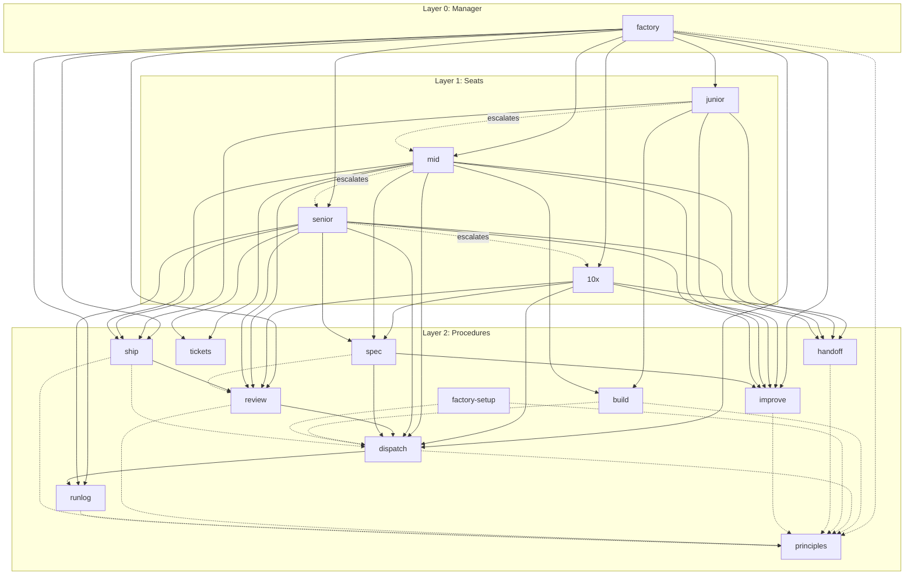

# Skill graph

> Generated by `node scripts/validate.mjs --write` from the `metadata` block of each `SKILL.md`. Do not edit by hand.

Solid arrows: the skill loads the other skill when a step needs it. Dotted arrows: it only reads one of the other skill's reference files. Dashed arrows between seats: escalation.

## Who loads what

| Skill | Layer | Typed by you | Loads | Reads a file from | Escalates to | Reference files |
|---|---|---|---|---|---|---|
| `factory` | 0 Manager | yes | improve, junior, mid, senior, 10x, dispatch, review, ship, runlog | principles | none | none |
| `10x` | 1 Seats | yes | improve, spec, dispatch, review, handoff | none | none | extras.md |
| `junior` | 1 Seats | yes | improve, build, ship, handoff | none | mid | extras.md |
| `mid` | 1 Seats | yes | improve, spec, tickets, build, review, ship, dispatch, handoff | none | senior | extras.md |
| `senior` | 1 Seats | yes | improve, spec, tickets, dispatch, review, ship, handoff, runlog | none | 10x | extras.md |
| `build` | 2 Procedures | no | none | dispatch, principles | none | none |
| `dispatch` | 2 Procedures | no | runlog | principles | none | allocation.md, brief.md, harness.md, report-format.md |
| `factory-setup` | 2 Procedures | yes | none | principles, dispatch | none | fleet.md, machine.md, project.md |
| `handoff` | 2 Procedures | yes | none | principles | none | none |
| `improve` | 2 Procedures | yes | none | principles | none | brief-format.md, sizing.md |
| `principles` | 2 Procedures | no | none | none | none | attack-the-premise.md, evidence.md, independent-review.md, locations.md, smallest-change.md, terse-output.md, test-behaviour.md, text-is-data.md |
| `review` | 2 Procedures | yes | dispatch | principles | none | attacks.md, council.md, fix-loop.md, level.md, recheck.md, verdict.md |
| `runlog` | 2 Procedures | no | none | principles | none | reflect.md |
| `ship` | 2 Procedures | yes | review | dispatch, principles | none | none |
| `spec` | 2 Procedures | yes | improve, dispatch | review | none | none |
| `tickets` | 2 Procedures | no | none | none | none | ticket-format.md |

## Used by

| Skill | Loaded by |
|---|---|
| `factory` | you, by name |
| `10x` | factory |
| `junior` | factory |
| `mid` | factory |
| `senior` | factory |
| `build` | junior, mid |
| `dispatch` | factory, 10x, mid, senior, review, spec |
| `factory-setup` | you, by name |
| `handoff` | 10x, junior, mid, senior |
| `improve` | factory, 10x, junior, mid, senior, spec |
| `principles` | you, by name |
| `review` | factory, 10x, mid, senior, ship |
| `runlog` | factory, senior, dispatch |
| `ship` | factory, junior, mid, senior |
| `spec` | 10x, mid, senior |
| `tickets` | mid, senior |

## Size

| Skill | Lines | Bytes | Description chars |
|---|---|---|---|
| `factory` | 132 | 6286 | 69 |
| `10x` | 78 | 3188 | 68 |
| `junior` | 64 | 2446 | 63 |
| `mid` | 70 | 2749 | 69 |
| `senior` | 74 | 2898 | 69 |
| `build` | 98 | 3878 | 127 |
| `dispatch` | 137 | 5784 | 150 |
| `factory-setup` | 132 | 6764 | 69 |
| `handoff` | 83 | 3413 | 60 |
| `improve` | 105 | 5035 | 62 |
| `principles` | 36 | 1598 | 134 |
| `review` | 141 | 6297 | 65 |
| `runlog` | 124 | 4813 | 145 |
| `ship` | 166 | 7683 | 55 |
| `spec` | 107 | 3598 | 62 |
| `tickets` | 72 | 2765 | 136 |
| **Total** | | **69195** | **1403** |

Descriptions of the 11 skills you can type: 711 chars.

## Context cost

What a session reads when you call a skill. **Standing cost is zero**: every skill sets `disable-model-invocation: true`, so nothing sits in the model's context until it is called. Tokens are bytes divided by 4, rounded to 100. That is an estimate. The run log holds measured numbers.

| You type | Its own `SKILL.md` | With its reference files | Upper bound: everything it can load |
|---|---|---|---|
| `/factory` | ~1600 | ~1600 | ~25800 |
| `/10x` | ~800 | ~800 | ~18200 |
| `/junior` | ~600 | ~600 | ~20000 |
| `/mid` | ~700 | ~700 | ~22100 |
| `/senior` | ~700 | ~700 | ~21200 |
| `/factory-setup` | ~1700 | ~6500 | ~12300 |
| `/handoff` | ~900 | ~900 | ~1800 |
| `/improve` | ~1300 | ~2300 | ~3300 |
| `/review` | ~1600 | ~4500 | ~13400 |
| `/ship` | ~1900 | ~1900 | ~15300 |
| `/spec` | ~900 | ~900 | ~15000 |

The upper bound is never paid in one run. A skill loads another only when its step starts, and reads a principle or reference file only when a line points at it. A worker is a separate session: it pays for its seat and the procedures it uses, not for the manager's.
