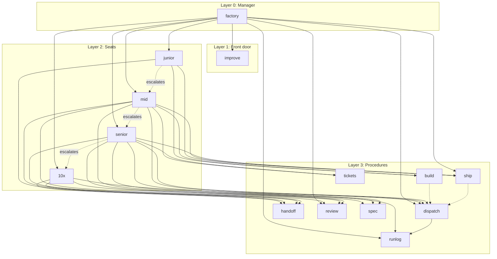

# Skill graph

> Generated by `node scripts/validate.mjs --write` from the `metadata` block of each `SKILL.md`. Do not edit by hand.

Solid arrows: the skill loads the other skill when a step needs it. Dotted arrows: it only reads one of the other skill's reference files. Dashed arrows between seats: escalation.

## Who loads what

| Skill | Layer | Typed by you | Loads | Reads a file from | Escalates to | Reference files |
|---|---|---|---|---|---|---|
| `factory` | 0 Manager | yes | improve, junior, mid, senior, 10x, dispatch, review, ship, runlog | none | none | none |
| `improve` | 1 Front door | yes | none | none | none | brief-format.md, sizing.md |
| `10x` | 2 Seats | yes | spec, dispatch, review, handoff | none | none | extras.md |
| `junior` | 2 Seats | yes | build, ship, handoff | none | mid | extras.md |
| `mid` | 2 Seats | yes | spec, tickets, build, review, ship, dispatch, handoff | none | senior | extras.md |
| `senior` | 2 Seats | yes | spec, tickets, dispatch, review, ship, handoff, runlog | none | 10x | extras.md |
| `build` | 3 Procedures | no | none | dispatch | none | none |
| `dispatch` | 3 Procedures | no | runlog | none | none | allocation.md, harness.md, report-format.md |
| `handoff` | 3 Procedures | no | none | none | none | none |
| `review` | 3 Procedures | no | none | none | none | none |
| `runlog` | 3 Procedures | no | none | none | none | none |
| `ship` | 3 Procedures | no | none | dispatch | none | none |
| `spec` | 3 Procedures | no | none | none | none | none |
| `tickets` | 3 Procedures | no | none | none | none | ticket-format.md |

## Used by

| Skill | Loaded by |
|---|---|
| `factory` | you, by name |
| `improve` | factory |
| `10x` | factory |
| `junior` | factory |
| `mid` | factory |
| `senior` | factory |
| `build` | junior, mid |
| `dispatch` | factory, 10x, mid, senior |
| `handoff` | 10x, junior, mid, senior |
| `review` | factory, 10x, mid, senior |
| `runlog` | factory, senior, dispatch |
| `ship` | factory, junior, mid, senior |
| `spec` | 10x, mid, senior |
| `tickets` | mid, senior |

## Size

| Skill | Lines | Bytes | Description chars |
|---|---|---|---|
| `factory` | 125 | 5824 | 189 |
| `improve` | 91 | 4096 | 145 |
| `10x` | 86 | 3712 | 215 |
| `junior` | 63 | 2207 | 146 |
| `mid` | 70 | 2639 | 160 |
| `senior` | 76 | 2890 | 172 |
| `build` | 101 | 3818 | 127 |
| `dispatch` | 132 | 5495 | 150 |
| `handoff` | 68 | 2547 | 136 |
| `review` | 112 | 4224 | 123 |
| `runlog` | 94 | 3447 | 145 |
| `ship` | 100 | 3869 | 130 |
| `spec` | 98 | 3080 | 144 |
| `tickets` | 71 | 2692 | 136 |
| **Total** | | **50540** | **2118** |

Descriptions of the 6 skills you can type: 1027 chars.
