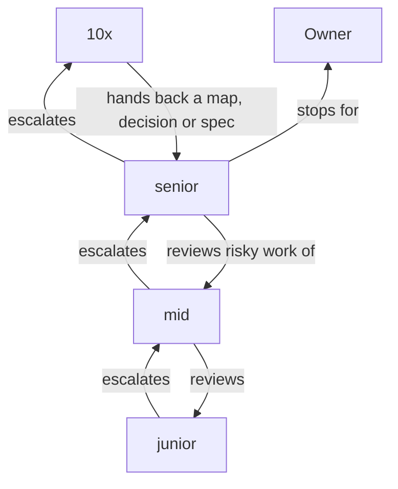
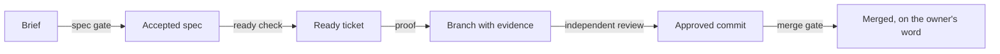

# Organisation and validation

Who checks what, how "done" is established, and which rules are enforced by
code and which only by instruction.

## Who answers to whom

| Seat | Decides alone | Must ask |
|---|---|---|
| junior | How to implement inside `Touches` | Anything outside the ticket, any missing fact |
| mid | Ticket slicing, file ownership, normal-risk review | High-risk changes, running builders in parallel |
| senior | Spec waivers for tiny fixes, fan-out, whether the gate is met | Open design questions, and the word to merge |
| 10x | How to frame a hard problem | Nothing routine. It hands back and leaves |
| owner | Accepting a spec, answering design questions, merging | n/a |

Escalation moves the problem up with the evidence attached. It is not a
failure. A junior that stops with an exact question costs less than one that
guesses.

## Four checks between a task and a merge

| Check | Question | Fails when |
|---|---|---|
| **Spec gate** | Do we know what to build? | Any open design question remains |
| **Ready check** | Can a stranger build this without colliding? | No `Touches`, no seam, an overlap, or a question in the ticket |
| **Proof** | Did the builder see it work? | A check is unrun, or "passes" is asserted without output |
| **Review** | Does someone else agree it is right? | A Critical or Important finding is open |
| **Merge gate** | Is this exact commit safe to merge? | Any of the seven conditions fails on the latest commit |

A `small` task replaces the first two with three scope lines on the brief
(`Touches`, `Must not touch`, `Seam to test`). A `trivial` task skips to proof
and is left for the owner as an uncommitted change. Nothing skips proof.

## Review, in one paragraph

The reviewer is a different agent with a clean context. It gets the ticket,
the spec section and the diff. It reviews two axes separately: does the diff do
what was asked, and is it sound. It reports findings with a severity and a
concrete case, skips style, and gives one verdict. A send-back goes to the
original author, up to the round cap written in `skills/review/SKILL.md`. Then
the ticket moves up a seat. High-risk changes also get a review by a model from a
different provider, so that one model's blind spot is not shared by its
reviewer.

## Mechanism or prose

A rule in a skill file is advice the model usually follows. A rule that must
hold every time needs something that fails loudly. This table is honest about
which is which.

| Rule | Enforced by | Strength |
|---|---|---|
| Skill names, layers, links, sizes, no upward edges, no cycles | `scripts/validate.mjs`, run in CI on every push | **Mechanism** |
| The dependency graph matches the skills | Generated from metadata, CI fails if stale | **Mechanism** |
| Every extra names a full commit | `upstream.lock.json`, checked by the validator | **Mechanism** |
| Every pinned extra exists, and any skill it calls from its own library is pinned too (or listed in `ignoredCalls` with a reason) | `validate.mjs --upstream`, run in CI after fetching the pinned commits | **Mechanism**. Calls are found by pattern (Skill tool, `../name/`, `name/SKILL.md`); a bare mention is only a warning |
| The clones on a machine are at those commits | `scripts/sync-upstream.mjs --status` | Mechanism, once it is run |
| Install never overwrites other skills | `scripts/install.mjs` refuses | **Mechanism** |
| Run rows have valid fields | `scripts/runlog.mjs` rejects bad values | **Mechanism**, once it is called |
| Required checks green, approval on the head commit, no changes requested, no conflicts | `scripts/gate.mjs` reads the PR | **Mechanism**, once it is called. Weak where a repository requires no checks, and where author and reviewer share one account |
| A junior does not dispatch or approve | Its seat lists no `dispatch` or `review`. Nothing stops an agent reading the file anyway | Prose |
| Builders stay inside `Touches` | Reviewer checks the diff against the ticket | Prose, checked by a second agent |
| The author does not review their own work | Reviewer is started fresh by the manager | Prose |
| Proof was actually observed | Reviewer and gate read the quoted output | Prose, checked by a second agent |
| The manager writes the run row | Instruction in `factory` | **Prose only** |
| The manager runs the gate script | Instruction in `ship` | **Prose only** |
| Caps and the clone gate | Instruction in `dispatch` | **Prose only** |
| Merge only on the owner's word | Instruction in `ship` | **Prose only** |

## Turning the prose-only rows into mechanisms

In order of value. None of these is installed by this repository.

1. **A stop hook that writes the run row.** The harness already emits an event
   when a session or subagent stops. A hook can call `runlog.mjs` with what the
   harness knows (model, tokens, time), so the row no longer depends on the
   manager remembering.
2. **Branch protection.** Require the CI checks and one approval on the
   default branch. Then the gate holds even if an agent ignores `ship`.
3. **A CI job that runs `gate.mjs`** and reports it as a status check.
4. **A `Touches` check in CI.** Compare the PR's changed files with the
   `Touches` line of its ticket and fail on anything outside.
5. **A second reviewer identity.** A bot account or a second login, so an
   approval on GitHub is a real second party and not a comment.

## How the skills themselves are validated

- **Structure:** `node scripts/validate.mjs` on every push.
- **Behaviour:** the scenarios in `evals/scenarios.md`. Each gives an input and
  the behaviour that must result. Run them by hand against a new model or after
  changing `improve`, `factory` or `dispatch`, on a weak model as well as a
  strong one. A skill that only works on the strongest model is too vague.
- **In use:** the run log's `lesson` field. The same lesson three times means
  the skill that owns the rule changes.
